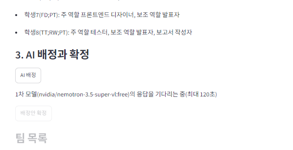
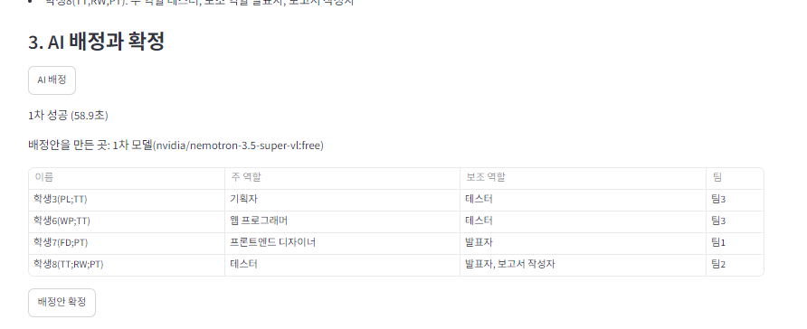
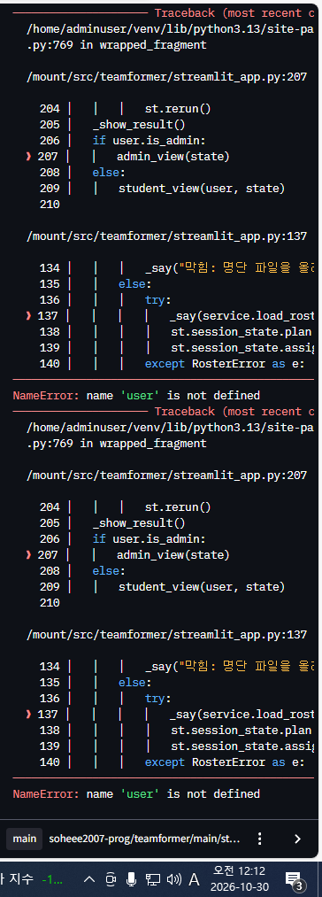
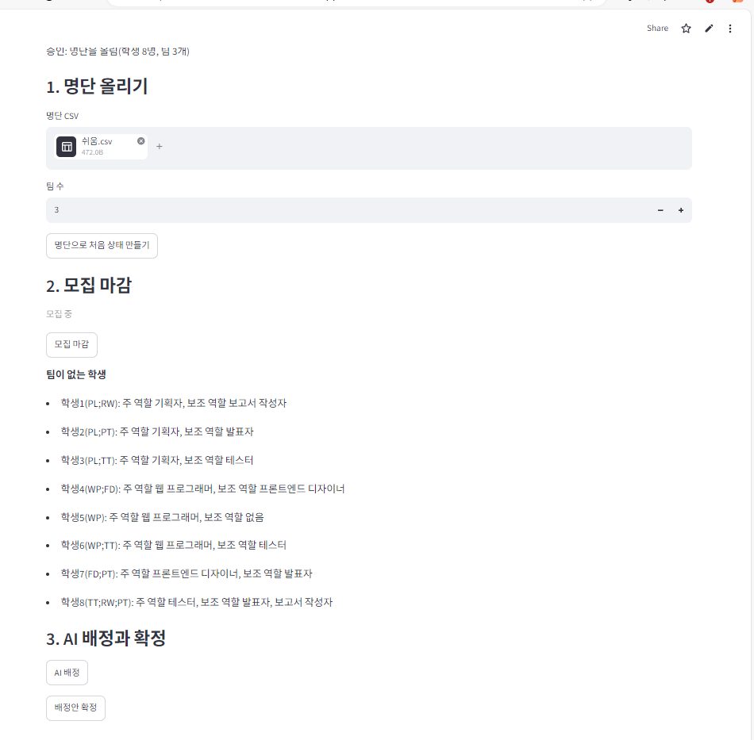

<!-- 생성: 2026-10-30 01:09 KST -->
# 팀 프로젝트를 위한 팀 편성 웹 앱

학생들이 팀에 지원하고 팀원들이 찬성 또는 거부로 받아들이며, 모집 마감 뒤 남은 학생은 AI가 배정하고 앱이 그 배정을 규칙으로 검사하는 Streamlit 앱이다.

## 1. 배포 주소

https://teamformer-sohee.streamlit.app

- 관리자: 학번 `admin`, 비밀번호는 e-class 제출 칸에 적음
- 학생: 명단 CSV의 학번, 비밀번호는 모두 `1234`

## 2. PRD와 구현 계획의 위치

- PRD: [docs/PRD.md](docs/PRD.md)
- 구현 계획: [docs/구현계획.md](docs/구현계획.md)

## 3. 고른 해결 방법

공고 3장의 기능은 모두 **어려운 해결**로 만들었다.

| 기능 | 고른 해결 | 어떻게 만들었나 |
|---|---|---|
| 다른 사람의 변경 보기 | 어려운 해결 | 로그인 뒤 화면 전체를 `st.fragment(run_every=5)`로 감싸 5초마다 바뀐 부분만 다시 그림(`streamlit_app.py`의 `main_view`) |
| 필수 포함 역할을 지킬 수 없는 팀 | 어려운 해결 | 지원할 때 "남는 자리 수 < 아직 못 채운 필수 역할 수"이면 막음. 기획자와 웹 프로그래머는 서로 다른 학생으로 셈(`rules.py`의 `apply_block_reason`, `filled_required`) |
| 같은 팀에 대기 중인 지원이 여럿 | 어려운 해결 | 팀원 모두가 찬성한 순간, 그때의 팀원으로 규칙을 다시 검사해 승인하거나 거절함. 처리 순서는 투표가 끝난 순서(`service.py`의 `vote`) |
| 마지막 자리에 두 명이 동시에 들어감 | 어려운 해결 | `tf_members`의 기본 키 `(team_id, slot_no)`와 `student_id` 유일성 제약(`schema.sql`). 지원과 투표는 팀 행을 `FOR UPDATE`로 잠근 트랜잭션에서 처리 |
| AI 응답이 늦을 때 | 어려운 해결 | 요청을 별도 스레드에서 보내고 `future.result(timeout=120)`으로 응답을 다 받을 때까지의 **전체 시간**을 재서 끊고 다음 모델로 넘어감(`ai.py`의 `call_model`) |
| 3차 모델까지 실패 | 어려운 해결 | 남은 학생을 팀에 넣는 모든 경우를 백트래킹으로 따져 5가지 검사를 모두 통과하는 배정을 찾음(`rules.py`의 `solve`) |
| AI 대기 중 화면 | 어려운 해결 | `assign_status` 안에 "2차 모델(모델 이름)의 응답을 기다리는 중(최대 120초)"처럼 몇 차 모델을 기다리는지 보여 줌 |
| DB(Supabase)가 일시정지되지 않게 | 어려운 해결 | GitHub Actions 예약 작업이 매일 09:00(KST)에 DB에 질의함(`.github/workflows/keepalive.yml`) |



## 4. 쓴 모델 3개

| 차례 | 모델 |
|---|---|
| 1차 | `nvidia/nemotron-3.5-super-vl:free` |
| 2차 | `google/gemma-4-31b-it:free` |
| 3차 | `dots-studio/dots-3-note-preview:free` |

2026-10-29 23:08에 무료 텍스트 모델 후보 5개에게 같은 배정 문제를 한 번씩 보내, 유일하게 통과한 모델을 1차로 정했다. 2차와 3차는 회사가 서로 다른 모델로 골라 함께 막힐 위험을 줄였다. 기록: [docs/evidence/model-test-2026-10-29.txt](docs/evidence/model-test-2026-10-29.txt)

## 5. AI 모델 호출 실패 사례

### 사례 1: 1차, 3차는 빈 응답, 2차는 429로 실패해 앱이 스스로 배정함

- 언제: 2026-10-29 23:48, 중간 시나리오의 마감 직후 상태(남은 학생 8명, 빈 팀 2개)로 `ai.assign`을 실행
- 결과: 1차 **빈 응답**(67.0초), 2차 **HTTP 429**(1.4초), 3차 **빈 응답**(44.2초). 3차까지 실패해 앱이 스스로 배정했고, 그 배정은 규칙을 모두 지켰다.
- 기록: [docs/evidence/ai-assign-2026-10-29-2348.txt](docs/evidence/ai-assign-2026-10-29-2348.txt)
- 원인과 대응: 추론 모델이 생각하는 데 `max_tokens`(4000)를 다 써서 답을 내지 못한 것으로 보았다. 공고 4.3절의 조언대로 `max_tokens`를 16000으로 늘렸고(커밋 `deef579`), 4분 뒤 같은 상태로 다시 실행하자 1차 모델이 86.7초에 검사를 통과한 배정안을 냈다([기록](docs/evidence/ai-assign-2026-10-29-2352.txt)).

### 사례 2: 후보 시험에서 429, 빈 응답, 120초 초과가 모두 나옴

- 언제: 2026-10-29 23:08, 모델 고르기 시험
- 결과: `google/gemma-4-31b-it:free`, `google/gemma-4-26b-a4b-it:free`는 **HTTP 429**, `dots-studio/dots-3-note-preview:free`는 **빈 응답**, `nvidia/nemotron-3-ultra-550b-a55b:free`는 **120초 넘게 응답이 없어** 시험 코드가 끊었다.
- 기록: [docs/evidence/model-test-2026-10-29.txt](docs/evidence/model-test-2026-10-29.txt)

### 사례 3: 키가 만료되어 3개 모델이 모두 HTTP 401

- 언제: 2026-10-29 23:36
- 결과: 1, 2, 3차 모두 **HTTP 401**로 실패했고 앱이 스스로 배정했다. 같은 시각 키 정보 조회도 401이었다. 오픈라우터 키 목록에서 앱에 넣은 키가 **Expired** 상태인 것을 확인했다. 키를 만들 때 만료 기간이 짧게 정해져 있었다. 만료 없는 키를 새로 만들어 바꿨다.
- 기록: [docs/evidence/ai-assign-401-2026-10-29.txt](docs/evidence/ai-assign-401-2026-10-29.txt), 화면 [img/openrouter-key-expired.png](img/openrouter-key-expired.png)

사례 1~3의 기록은 앱 화면이 아니라 앱과 같은 함수(`ai.assign`)를 실행한 시험 코드(`scripts/try_ai_assign.py`, `scripts/test_models.py`)의 출력이다. 배포한 앱에서는 연습 시나리오 3개 모두 1차 모델이 성공했다(58.9초, 46.6초, 48.9초).



## 6. 클로드가 잘못된 추론이나 답변을 한 사례

### 사례 1: 관리자 화면에 없는 변수를 써서 배포 앱의 관리자 단추가 오류를 냄

- 무엇: 최종 코드 검토의 지적("관리자 기능은 처리 함수에서도 관리자인지 확인")을 반영하면서, 클로드가 `admin_view` 안에 `user.student_no`를 넣었다. 그런데 `admin_view`는 `user`를 받지 않는 함수였다(커밋 `b8457a6`). 자동 시험 56개는 모두 통과했는데, 화면 시험이 관리자 단추를 **누르는** 경우를 시험하지 않았기 때문이다.
- 알아챈 방법: 배포한 앱에서 관리자로 로그인해 "명단으로 처음 상태 만들기"를 눌렀더니 `NameError: name 'user' is not defined`가 났다.
- 고친 것: `admin_view`가 `user`를 받게 하고, 관리자 단추를 실제로 누르는 시험을 더했다(커밋 `19590c5`). 다시 배포한 뒤 "승인: 명단을 올림"을 확인했다.




### 사례 2: 새 파일의 생성 시각을 확인하지 않고 지어서 적음

- 무엇: 내 전역 지침에는 "새 파일 첫머리의 생성 시각은 추측하지 말고 PowerShell로 확인한다"는 규칙이 있다. 클로드는 시각을 한 번만 확인하고 그 뒤 10분 넘게 만든 파일에도 같은 시각(23:25)을 적었고, 확인하기 전에 미래 시각(23:40, 00:00)을 적기도 했다.
- 알아챈 방법: 모델 시험 기록 첫 줄의 실제 시각(23:08)이 시험 코드 첫머리에 적힌 시각(23:40)보다 앞서 있었다. 그 뒤 파일 시스템의 생성 시각과 첫머리 시각을 모두 비교해 차이를 찾았다.
- 고친 것: 실제 생성 시각으로 고쳤다(커밋 `5f4d4e1`).

### 사례 3: 시험 코드가 관리자 비밀번호를 시험용 값으로 바꾼 채 남김

- 무엇: 관리자 계정 시험이 비밀번호를 `pw1`, `pw2`로 바꾸고 원래대로 돌려놓지 않았다. 배포한 앱과 같은 DB를 쓰므로, 시험을 돌리면 배포 앱의 관리자 로그인이 깨질 수 있었다.
- 알아챈 방법: 최종 검토 결과를 반영하면서 시험이 실제 DB에 남기는 영향을 따져 보다 발견했다.
- 고친 것: 시험 전후로 관리자 비밀번호를 `ADMIN_PASSWORD`로 되돌리는 `tests/conftest.py`를 더했다(커밋 `b8457a6`).

## 7. 앱에서 발견한 문제점과 개선할 점

### 문제 1: 보조 역할의 순서가 명단과 다르게 보임

- 발견한 곳: 부록 1(쉬움) 명단을 올린 직후 관리자 화면
- 내용: 명단 CSV에서 학생8의 보조 역할은 `보고서 작성자;발표자` 순서인데, 화면에는 "발표자, 보고서 작성자"로 보인다. DB에서 보조 역할을 읽을 때 이름순으로 정렬하기 때문이다. 규칙 검사에는 영향이 없지만 명단과 화면을 비교할 때 헷갈린다.
- 화면: [img/roster-ok.png](img/roster-ok.png)

### 문제 2: 다시 로그인하면 팀 수 칸이 3으로 돌아감

- 발견한 곳: 부록 2(중간) 9단계, 관리자가 모집을 마감한 화면
- 내용: 명단을 올릴 때 팀 수를 4로 넣었지만, 로그아웃하고 다시 로그인하면 팀 수 칸이 기본값 3으로 보인다. 실제 팀은 4개라 동작에는 문제가 없지만, 관리자가 팀 수를 잘못 안 채 명단을 다시 올리면 팀이 3개로 만들어질 수 있다.
- 화면: [img/medium-step9-close.png](img/medium-step9-close.png)

### 문제 3: AI를 기다리는 동안 화면이 흐려지고 얼마나 지났는지 알 수 없음

- 발견한 곳: 부록 1(쉬움) 6단계, AI 배정
- 내용: 몇 차 모델을 기다리는지는 보이지만, 기다리는 동안 아래의 "배정안 확정" 단추와 팀 목록이 흐려지고 1분 가까이 바뀌지 않는다. 지난 시간을 함께 보여 주면 멈춘 것인지 기다리는 것인지 알기 쉽겠다.
- 화면: [img/ai-waiting.png](img/ai-waiting.png)

## 연습 시나리오 확인 (배포한 앱, 2026-10-30)

| 시나리오 | 결과 | 주요 화면 |
|---|---|---|
| 부록 1 쉬움 | 4단계 거절, 확정 뒤 모든 팀이 규칙을 지킴. 5단계는 빠뜨리고 진행해 팀3이 빈 팀인 채로 배정함 | [거절](img/easy-step4-reject.png), [확정](img/easy-final.png) |
| 부록 2 중간 | 3단계 막힘(주 역할 중복), 8단계 지원 단추 비활성, 9단계 마감, 10단계 막힘(마감), 확정 뒤 규칙 지킴 | [3단계](img/medium-step3-block-same-role.png), [내 투표](img/medium-step6-my-vote.png), [확정](img/medium-final.png) |
| 부록 3 어려움 | 8단계 거절(승인 직전 재검사), 11단계 막힘(필수 포함 역할 자리), 확정 뒤 규칙 지킴. 팀4는 보조 역할로 기획자와 웹 프로그래머를 채움 | [8단계](img/hard-step8-reject-recheck.png), [11단계](img/hard-step11-block-required.png), [확정](img/hard-final.png) |

자동 시험(`tests/test_scenarios.py`)도 같은 세 시나리오의 모든 단계를 실행해 기대 결과와 비교한다.

## 실행 방법(내 PC)

```bash
pip install -r requirements.txt pytest
python scripts/apply_schema.py
streamlit run streamlit_app.py
python -m pytest
```

`.env`에 `OPENROUTER_API_KEY`, `DATABASE_URL`, `ADMIN_PASSWORD`가 있어야 한다. 시험은 실제 Supabase를 쓰므로 앱 데이터가 초기화된다.
